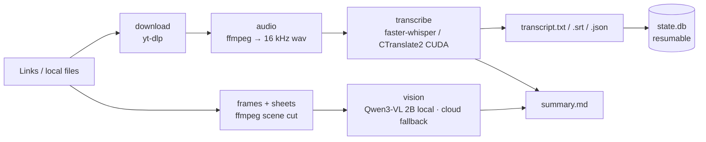

<p align="center">
  
</p>

<h1 align="center">Vidigest</h1>

<p align="center">
  <b>Turn a queue of online videos into structured documents on your own disk</b><br>
  download &nbsp;·&nbsp; GPU transcription &nbsp;·&nbsp; frame contact sheets &nbsp;·&nbsp; AI summary
</p>

<p align="center">
  
  
  
  
  
  
</p>

<p align="center">
  <a href="#quick-start">Quick start</a> ·
  <a href="#what-you-get">Output</a> ·
  <a href="#how-it-works">How it works</a> ·
  <a href="#performance">Performance</a> ·
  <a href="#faq">FAQ</a> ·
  <a href="README.md">中文文档</a>
</p>

---

> This is the English summary. The full README is maintained in Chinese
> ([`README.md`](README.md)) — the project's docs, design notes and engineering rules are all
> written in Chinese, so the Chinese README is the source of truth.

## What it is

Vidigest is a Windows desktop application. You paste a list of video links — Douyin, Bilibili,
YouTube, X — and get one folder per video containing:

- a transcript with **real timestamps** (`.txt`, `.srt`, `.json`),
- a contact sheet of scene-cut keyframes (`sheets/*.jpg`),
- an AI-written `summary.md` (optional).

Transcription runs on **your own GPU** through faster-whisper + CTranslate2. Nothing is uploaded.
There is no per-minute billing, no quota, and it keeps working offline once the models are on disk.

Two numbers that define the project:

| | |
|---|---|
| 20-minute video, GPU (large-v3 float16) | **2 min 18 s**, 662 segments |
| same on CPU (int8) | 13 min 54 s — **6.0× slower** |

## Features

| | |
|---|---|
| **Multi-platform download** | Douyin (paste the share text, URLs are extracted), Bilibili, YouTube, X, or local files |
| **Local GPU transcription** | faster-whisper `large-v3` + CTranslate2 → `txt` / `srt` / `json` |
| **Resumable** | Task state lives in `state.db`. Kill the process, restart, and finished work is not redone; half-done work falls back to the last stable state |
| **Pipelined scheduling** | download / transcribe / frame-extraction overlap; the transcription pool is pinned to **1** (single GPU), download and frame pools scale to measured free memory |
| **Frame contact sheets** | scene detection → 6×4 grids; ~9 sheets for a 20-minute video |
| **Vision + summary** | contact sheets go to Qwen3-VL 2B (local, GGUF via llama.cpp) or your own cloud API. **Local first, cloud as fallback, and a clear message when neither is available** |
| **GUI** | Rust + Tauri 2. Models are *not* bundled — the settings page downloads them on demand |
| **Single-file distribution** | The target machine needs neither Python nor Rust; the Python side ships as a PyInstaller sidecar |

## Screenshots

<p align="center">
  
</p>
<p align="center"><sub>Main window. Each task is a two-line list: the title gets the full width, while status / four-stage dots (download → transcribe → frames → summary) / progress / elapsed collapse into a metadata line. The default window is 800×600 — the layout is designed for it.</sub></p>

<p align="center">
  
</p>
<p align="center"><sub>Settings: six categories on the left (models, transcription, vision, summary, storage, maintenance), one card per concern on the right.</sub></p>

## Quick start

### Option A — installer

> ⚠️ **No Release has been published yet.** Build the MSI yourself with `./dev.sh release`
> (~8 minutes), see Option B. The first Release is waiting on clean-machine verification.

Install the `.msi`, launch, then:

1. **Settings → Storage**: pick an output directory and a model directory.
2. **Settings → Models**: click *Download* for the speech model (~2.9 GB); optionally download the
   vision model (~2.3 GB).
3. **Main window**: paste links (one per line), press *Start*.

Data lives in `%LOCALAPPDATA%\Vidigest`; output goes wherever you pointed it, and uninstalling does
not delete it.

### Option B — from source

| Component | Requirement |
|---|---|
| Windows | 10 / 11 x64 — **the only platform verified so far** |
| Python | 3.13 |
| NVIDIA GPU | ≥ 8 GB VRAM, driver supporting CUDA 12 (measured on RTX 4060 Ti 16 GB) |
| ffmpeg | **9.x full build** (`-vsync` was removed in 9.0) — `winget install --id Gyan.FFmpeg -e` |
| yt-dlp | latest — `pip install -U yt-dlp` |
| Rust + Node.js | only needed to build the GUI |

```bash
git clone https://github.com/benntqoo/Vidnote.git && cd Vidnote
python -m venv .venv && .venv/Scripts/activate

pip install -r requirements.txt
pip install nvidia-cublas-cu12 nvidia-cudnn-cu12 nvidia-cuda-nvrtc-cu12   # CUDA runtime, not on PATH

cp config.example.yaml config.yaml                                        # edit paths.*
python -m app.cli env --verify                                            # real inference check, ~5 s
```

Download the speech model (~2.9 GB, not in the repo) into `models/large-v3/`:

```bash
mkdir -p models/large-v3 && cd models/large-v3
for f in config.json preprocessor_config.json tokenizer.json vocabulary.json model.bin; do
  curl -sL --retry 5 --retry-delay 3 -C - -o "$f" \
    "https://hf-mirror.com/Systran/faster-whisper-large-v3/resolve/main/$f" &
done; wait
```

```bash
python -m app.cli run "https://v.douyin.com/xxxxx/" --cookies cookies.txt   # one video
python -m app.cli run --file urls.txt --limit 10                            # batch
python -m app.cli list                                                      # task table
./dev.sh release                                                            # build the MSI
```

## What you get

```
<work_dir>/0001_<sanitised title>/
├── video.mp4
├── audio.wav                 # 16 kHz mono, the transcription input
├── transcript.txt            # plain text
├── transcript.srt            # subtitles
├── transcript.json           # segments with start/end seconds
├── frames/                   # scene-cut keyframes
├── sheets/                   # 6×4 contact sheets (what the vision model sees)
├── visual.md                 # per-sheet visual description, with real time ranges
└── summary.md                # structured summary (when an AI backend is available)
```

## How it works



The boundary is deliberate: **Rust is only a window and a process supervisor; all computation is
Python** (packaged by PyInstaller into a resident worker that the host spawns). The two talk over
**JSON Lines on stdin/stdout** — no port, so no firewall prompt, no antivirus interference, no port
collisions. `stdout` carries protocol frames only; every log line goes to `stderr`.

## Performance

Measured on RTX 4060 Ti 16 GB, Windows 11, 20 min 04 s / 720p video:

| | measured |
|---|---|
| GPU transcription (large-v3 float16) | **2 min 18 s**, 662 segments |
| CPU transcription (int8) | 13 min 54 s, 646 segments (different segmentation — not comparable byte-wise) |
| Reproducibility | Two independent runs with identical settings produce **byte-identical** output, which is why acceptance can demand exact equality |
| Vision model (Qwen3-VL 2B Q4_K_M) | **1.8 s per contact sheet**, 3275 MiB VRAM |
| VRAM | speech model ~3–5 GB (estimate) + 3.3 GB vision — both resident on a 16 GB card |
| Installer size | **1.49 GiB** (models are not bundled) |

## Known limitations

- **Windows only.** The CLI is theoretically portable, but no macOS / Linux build or testing exists.
- **An NVIDIA GPU is required for practical speed** (6× gap, see above).
- **Douyin usually needs a logged-in cookie**, and even anonymous access needs a fresh `ttwid`
  (~24 h lifetime). The app reports "cookie expired" explicitly instead of failing silently.
- **No tray icon** — closing the window quits; "keep running in background" is not implemented.
- **No batch selection UI yet** — the backend can list an author's videos, the multi-select UI cannot.
- **Installer not verified on a clean machine** (this dev box has Python and Rust, so simulating
  is not proof).
- **No published Release yet.**

## FAQ

<details>
<summary><b>Why is there only an MSI and no <code>-setup.exe</code>?</b></summary>

The payload is 2.5 GiB, above NSIS's hard 2 GiB limit, and the Tauri template hardcodes `/SOLID`,
so changing compression does not help. NSIS was ruled out; only the WiX MSI remains.
</details>

<details>
<summary><b><code>cublas64_12.dll not found</code></b></summary>

The CUDA runtime is not on Windows' DLL search path, and load order matters: the value returned by
`os.add_dll_directory()` **must be kept alive**, the directory must also be added to `PATH`, and all
of this must happen before `import ctranslate2`. All three, or it fails.
</details>

<details>
<summary><b>Does <code>get_cuda_device_count() == 1</code> mean the GPU works?</b></summary>

No — it only means hardware was *detected*. The real check is running one inference, which is what
`python -m app.cli env --verify` does.
</details>

<details>
<summary><b>Why is the app called Vidigest but the repo Vidnote?</b></summary>

`VidNote` / `ViNote` / `VideoNote` were already taken. The application name was changed on
2026-10-14; the local directory and the GitHub repo name were intentionally left alone, because
renaming a repo breaks every existing clone and link.
</details>

## Development

```bash
./dev.sh check      # every fast criterion, seconds, no GPU needed
./dev.sh release    # build the MSI (~8 min: PyInstaller + Tauri, two layers)
```

| Layer | Command | Criteria |
|---|---|---|
| IPC protocol | `python tools/rpc_smoke.py` | 70 |
| Scheduler semantics | `python tools/dispatcher_selftest.py` | 66 |
| Download layer | `python tools/fetcher_selftest.py` | 7 |
| Model downloader | `python tools/model_downloader_selftest.py` | 11 |
| Main-window state view | `node --experimental-strip-types tools/main_layout_selftest.mts` | 24 |
| Rust unit tests | `cargo test --lib` | 23 |
| Packaged worker smoke | `python tools/build_worker.py` | 29 |
| Post-build check | `python tools/postcheck_packaged_worker.py` | 10 |
| End-to-end (real GPU, ~3 min) | `python tools/phase2_acceptance.py all` | 23 |

Read [`docs/工程约定.md`](docs/工程约定.md) before changing code: 60+ previously-hit traps, each
with the symptom that identifies it.

## Contributing

Issues and PRs are welcome. Please include your Windows version, GPU model, the output of
`python -m app.cli env`, and a link that reproduces the problem (**sanitise anything private**).

Every new behaviour is expected to come with a criterion — a script that runs on its own and
reports an explicit count, not "I checked it".

## License

[MIT](LICENSE) © 2026 Ben

Third-party components keep their upstream licenses: faster-whisper and CTranslate2 (MIT),
yt-dlp (Unlicense), Tauri (MIT / Apache-2.0), llama.cpp (MIT), Qwen3-VL weights (per upstream).
**ffmpeg is not redistributed** — install it yourself; its license depends on the build you pick
(GPL / LGPL).
