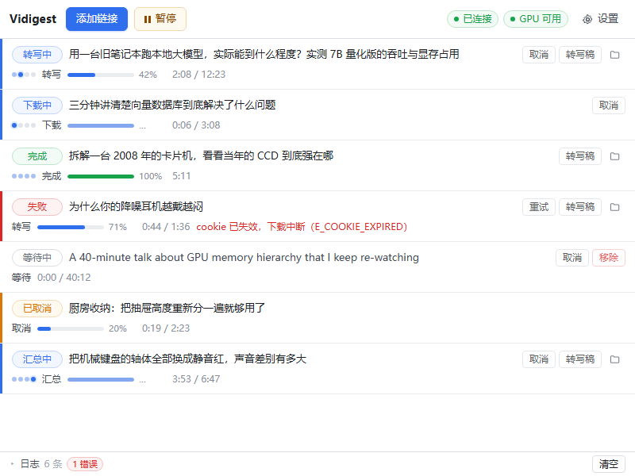
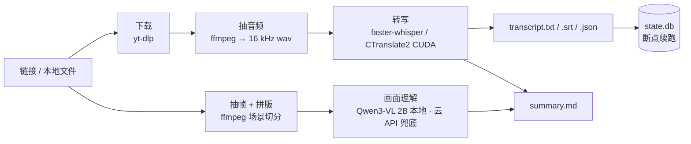

<p align="center">
  
</p>

<h1 align="center">Vidigest</h1>

<p align="center">
  <b>批量把在线视频转成留在自己硬盘上的结构化文稿</b><br>
  下载 &nbsp;·&nbsp; GPU 转写 &nbsp;·&nbsp; 抽帧拼版 &nbsp;·&nbsp; AI 汇总
</p>

<p align="center">
  
  
  
  
  
  
</p>

<p align="center">
  <a href="#快速开始">快速开始</a> ·
  <a href="#产出长什么样">产出</a> ·
  <a href="#工作原理">工作原理</a> ·
  <a href="#性能与硬件">性能</a> ·
  <a href="#常见问题">FAQ</a> ·
  <a href="#参与贡献">贡献</a> ·
  <a href="docs/PRD.md">产品文档</a>
</p>

---

**English** — Vidigest is a Windows desktop tool that turns a queue of online videos
(Douyin / Bilibili / YouTube / X) into local, structured documents: it downloads, transcribes
on your own GPU, cuts scenes into contact sheets, and writes a Markdown summary using either a
local 2B vision-language model or your own cloud API key. No upload, no per-minute billing,
everything stays on your disk. A 20-minute video is transcribed in **2m18s** on a mid-range
NVIDIA card, byte-for-byte reproducibly.
→ **[English README](README.en.md)**

---

## 它解决什么问题

想从一批视频里拿到文字，现在通常是这条路：手动下载 → 传到某家转写网站 → 等 → 复制粘贴 →
按分钟付费 → 内容出境。视频一多就不可行，而且你始终拿到的是「一份别人服务器上的文本」。

Vidigest 把它做成一条**本地流水线**：粘一批链接进去，产出是一个个文件夹——
带时间轴的转写稿（`.txt` / `.srt` / `.json`）、按镜头切好的帧图拼版、以及一份 `summary.md`。
模型跑在自己的显卡上，没有额度、没有按分钟计费、断网也能继续跑。

## 功能

| 能力 | 说明 |
|---|---|
| **多平台下载** | 抖音（分享文案直接粘贴，自动抽链接）、B站、YouTube、X；也可直接喂本地视频文件 |
| **本地 GPU 转写** | faster-whisper `large-v3` + CTranslate2，输出 `txt` / `srt` / `json` 三种形态 |
| **断点续跑** | 任务状态落 `state.db`。强杀进程后重启，已完成的不重跑，停在中间态的回退到上一个稳定态 |
| **流水线调度** | 下载 / 转写 / 抽帧三级流水线，阶段间重叠；转写恒为 1（单卡串行是物理事实），下载与抽帧并发数按实测可用内存动态规划 |
| **抽帧拼版** | 场景切分取关键帧，6×4 拼成一张图，20 分钟视频约 9 张 |
| **画面理解 + 汇总** | 拼版图交给 Qwen3-VL 2B（本地，GGUF + llama.cpp）或云 API，产出 `visual.md` / `summary.md`。**本地优先，起不来才走云，两级都不通时跳过并说明缺什么** |
| **桌面 GUI** | Rust + Tauri 2。模型不进安装包，设置为「点一下下载」 |
| **单文件分发** | 装完不需要目标机器上有 Python 或 Rust（Python 侧已打成 PyInstaller 产物随包分发） |

## 界面

<p align="center">
  
</p>

<p align="center"><sub>主界面：每条任务是两行式列表——标题独占一行，状态 / 四段阶段点（下载→转写→抽帧→汇总）/ 进度 / 耗时退成元信息行。800×600 是默认窗口尺寸。</sub></p>

<p align="center">
  
</p>

<p align="center"><sub>设置页：左侧六个分类（模型 · 转写 · 画面 · 汇总 · 存储 · 维护），右侧一卡一事。</sub></p>

## 快速开始

### 路线 A：装安装包

> ⚠️ **目前还没有发布 Release**，安装包需自行构建（见下方路线 B 的 `./dev.sh release`，
> 一条命令约 8 分钟）。首个 Release 待「干净机器验证」完成后发布。

拿到 `Vidigest_x.y.z_x64_en-US.msi` 后双击安装。装完启动，分三步：

1. **设置 → 存储**：选产出目录（默认挑剩余空间最大的非系统盘）与模型目录；
2. **设置 → 模型**：点「下载」拉语音模型（约 2.9 GB）；想要画面理解再拉视觉模型（约 2.3 GB）；
3. **主界面顶部**：粘贴链接（一行一条），点「开始」。

数据落在 `%LOCALAPPDATA%\Vidigest`，产出落在你自己选的目录，卸载不会删产出。

### 路线 B：从源码跑

**前置要求**

| 组件 | 要求 | 获取方式 |
|---|---|---|
| Windows | 10 / 11 x64（**目前只在 Windows 上验证过**） | — |
| Python | 3.13 | [python.org](https://www.python.org/downloads/) |
| NVIDIA GPU | 显存 ≥ 8 GB，驱动支持 CUDA 12（实测于 RTX 4060 Ti 16 GB / 驱动 610.88） | 显卡驱动 |
| ffmpeg | **9.x full build**（`-vsync` 自 9.0 起被移除，见 [FAQ](#常见问题)） | `winget install --id Gyan.FFmpeg -e` |
| yt-dlp | 最新版 | `pip install -U yt-dlp` |
| Rust + Node.js | 仅构建 GUI 需要 | `winget install Rustlang.Rustup` + VS Build Tools |

> **GPU 不是优化项，是前提。** 同一条 20 分钟音频：GPU（float16）**2 分 18 秒**，CPU（int8）
> **13 分 54 秒**，差 6.0 倍。100 条视频在 CPU 上要 23 小时，GPU 上 3.8 小时。

```bash
git clone https://github.com/benntqoo/Vidnote.git && cd Vidnote
python -m venv .venv && .venv/Scripts/activate

pip install -r requirements.txt
# Windows 上 CUDA 运行库不在 PATH 上，必须单独装
pip install nvidia-cublas-cu12 nvidia-cudnn-cu12 nvidia-cuda-nvrtc-cu12

cp config.example.yaml config.yaml     # 改 paths.work_dir / paths.model_dir
python -m app.cli env --verify         # 真跑一次推理，确认 CUDA 可用（约 5 秒，占 3 GB 显存）
```

模型（约 2.9 GB，不入库）从 `hf-mirror.com/Systran/faster-whisper-large-v3` 取，
放成 `models/large-v3/`。镜像对 LFS 文件会 302 到 xethub，`curl -C -` 断点续传最稳：

```bash
mkdir -p models/large-v3 && cd models/large-v3
for f in config.json preprocessor_config.json tokenizer.json vocabulary.json model.bin; do
  curl -sL --retry 5 --retry-delay 3 -C - -o "$f" \
    "https://hf-mirror.com/Systran/faster-whisper-large-v3/resolve/main/$f" &
done; wait
```

跑起来：

```bash
python -m app.cli run "https://v.douyin.com/xxxxx/" --cookies cookies.txt   # 单条
python -m app.cli run --file urls.txt --limit 10                            # 批量
python -m app.cli run --file urls.txt --jobs 1                              # 强制串行
python -m app.cli list                                                      # 看任务表
./dev.sh release                                                            # 出 MSI
```

完整参数：`python -m app.cli run --help`、`./dev.sh --help`。

## 产出长什么样

```
<work_dir>/0001_<安全化的标题>/
├── video.mp4                 # 原始视频（--no-keep-intermediate 可省）
├── audio.wav                 # 16 kHz 单声道，转写的输入
├── transcript.txt            # 纯文本，带段落
├── transcript.srt            # 字幕，带时间轴
├── transcript.json           # 分段结构化（每段的起止秒数 + 文本）
├── frames/                   # 场景切分后的关键帧
├── sheets/                   # 6×4 拼版图，喂给视觉模型的就是它们
├── visual.md                 # 画面理解结果（含每张拼版图覆盖的时间范围）
└── summary.md                # 汇总：结构化摘要（AI 后端可用时才生成）
```

`transcript.json` 的每一段都带**真实时间戳**（由音频时长算，不由模型猜），
所以 `.srt` 拖进任何播放器都能对上画面。

## 工作原理



分工是硬边界：**Rust 宿主只做窗口与进程管理，全部计算在 Python 侧**（PyInstaller 打成一个
常驻 worker，由宿主 spawn 并托管生命周期）。两侧用 **JSON Lines over stdin/stdout**
通信——不占端口，因此不需要防火墙规则、不会被安全软件拦、也不会和别的程序抢端口。
`stdout` 只走协议，所有日志走 `stderr`。

调度上只有一条设计约束：**转写池恒为 1**。单卡上并发转写只会互相抢显存并把总耗时拉长，
而下载与抽帧可以和转写重叠——所以「三级流水线」的收益全在掩盖下载延迟，不在并行转写。

## 性能与硬件

参考实测（RTX 4060 Ti 16 GB，Windows 11，20 分 04 秒 / 720p 视频）：

| 项目 | 实测值 |
|---|---|
| GPU 转写（large-v3 float16） | **2 分 18 秒**，662 段 |
| CPU 转写（int8） | 13 分 54 秒，646 段（分段边界与 GPU 版不同，不可逐字比对） |
| 转写可复现性 | 同配置两次独立运行产出**逐字节一致**——因此验收判据可以设成严格相等 |
| 视觉模型（Qwen3-VL 2B Q4_K_M） | **1.8 秒/张**拼版图，显存 3275 MiB |
| 显存占用 | 语音模型约 3–5 GB（估算）+ 视觉模型 3.3 GB，16 GB 卡上实测可共存 |
| 安装包体积 | **1.49 GiB**（模型不进包） |

磁盘：语音模型 2.9 GB + 视觉模型 2.3 GB，另加每条视频的产出
（20 分钟 720p 视频本体 44 MB，另加 9 张拼版图）。

## 配置

`config.yaml` 由 `config.example.yaml` 复制而来，字段语义见 [`PLAN.md`](PLAN.md) §5。
最常改的几个：

| 字段 | 作用 |
|---|---|
| `paths.work_dir` / `paths.model_dir` | 产出与模型的落点 |
| `runtime.device` / `compute_type` | `cuda` / `float16` 是默认；退到 `cpu` / `int8` 也能跑，但慢 6 倍 |
| `transcribe.language` / `initial_prompt` | 语言留空为自动检测；**`initial_prompt` 会改变分段与标点**，它影响验收基线，必须随基线一起记录 |
| `transcribe.beam_size` | 默认 5。降低可换速度 |
| `frames.enabled` / `max_sheets` | 是否抽帧拼版、最多出几张 |
| `vision.enabled` | 是否做画面理解（需要本地视觉模型或云 API） |
| `local_ai.enabled` / `server_path` / `model_dir` | 本地 llama.cpp 后端；路径留空时自动从模型目录里找 `llama-server.exe` |
| `summarize.enabled` | 是否生成 `summary.md`；两级后端都不可用时会被跳过并在日志里说明缺什么 |

云端的 API key **只从环境变量读**（默认 `VIDIGEST_API_KEY`，变量名可在 `summarize.api_key_env` 改），
写进配置文件会被丢弃并给出 `E_API_KEY_NOT_ALLOWED` 警告 —— 配置文件是明文的，密钥不该落在里面。

## 已知限制

- **只在 Windows 上验证过**。CLI 侧理论上跨平台，但没有 macOS / Linux 的构建与实测。
- **需要 NVIDIA GPU 才有实用速度**（见上方 6.0 倍差距）。
- **抖音多数内容需要登录后的 cookie**，且匿名访问也要求新鲜 `ttwid`（约 24 小时过期）。
  程序会明确提示「cookie 失效」，不会静默失败。
- **没有系统托盘**：关窗即退出，后台继续跑还没做。
- **批量勾选 UI 未做**：能按作者列出作品的后端已就绪，界面还没有多选。
- **未在干净机器上验证安装**：开发机同时装了 Python 与 Rust，而两者正是安装包声称
  「不需要」的东西，所以在同一台机器上验证等于没有验证。
- 目前**没有发布 Release**，只有自行构建的 MSI。

## 常见问题

<details>
<summary><b>为什么只有 MSI，没有 <code>-setup.exe</code>？</b></summary>

载荷 2.5 GiB 超过 NSIS 的 2 GiB 硬限制，且 Tauri 模板把 `/SOLID` 写死，改压缩档位无效。
NSIS 那条路已判死，只保留 WiX MSI。细节见 [`docs/打包与分发.md`](docs/打包与分发.md)。
</details>

<details>
<summary><b><code>cublas64_12.dll not found</code> 怎么办？</b></summary>

CUDA 运行库不在 Windows 的 DLL 搜索路径上，并且加载时序敏感：
`os.add_dll_directory()` 的返回值**必须被引用住**、还要把目录塞进 `PATH`、并且必须在
`import ctranslate2` 之前完成——三层缺一不可。代码里已按这个顺序处理，自己写脚本时注意同样三点。
</details>

<details>
<summary><b><code>get_cuda_device_count() == 1</code> 算不算 GPU 可用？</b></summary>

不算。它只说明**检测到了硬件**。真正的验证是跑一次真实推理——`python -m app.cli env --verify`
干的就是这件事。
</details>

<details>
<summary><b>ffmpeg 报 <code>Unrecognized option 'vsync'</code>？</b></summary>

ffmpeg 9.0 移除了 `-vsync`，本项目已改用 `-fps_mode passthrough`；报这个错说明你在跑旧代码或有
别的工具在调 ffmpeg。
</details>

<details>
<summary><b>为什么应用叫 Vidigest，仓库却叫 Vidnote？</b></summary>

`VidNote` / `ViNote` / `VideoNote` 在同类项目里都已被占用，所以 2026-10-14 把**应用名**改成了
`Vidigest`，而本地目录与 GitHub 仓库名刻意没动（改仓库名会让已有 clone 和链接全部失效）。
详见 [`docs/改名执行单.md`](docs/改名执行单.md)。
</details>

## 路线图

- [x] 核心流水线（下载 → 转写 → 抽帧）与逐字节可复现的验收基线
- [x] 并发调度、断点续跑、内存护栏
- [x] 桌面 GUI（Tauri + Python sidecar）与一键出包
- [x] 本地视觉模型（Qwen3-VL 2B）与「本地优先、云 API 兜底」
- [x] 模型改为装完点一下下载，不进安装包
- [ ] 批量勾选：按作者列出作品 → 多选 → 入队（后端就绪，UI 待做）
- [ ] 系统托盘 + 关窗后台继续
- [ ] 干净机器安装验证 → 首个 Release
- [ ] cookie 自动刷新
- [ ] macOS / Linux 支持（未验证，无排期）

## 开发与测试

```bash
./dev.sh check      # 全量判据，秒级，不需要 GPU
./dev.sh release    # 出 MSI（约 8 分钟，含 PyInstaller + Tauri 两层构建）
./dev.sh --help     # dev / bundle-dev / worker / check / clean
```

测试不是「有一个测试文件」，而是**按层拆开、每条判据都能单独跑**：

| 层 | 命令 | 判据数 |
|---|---|---|
| IPC 协议 | `python tools/rpc_smoke.py` | 73 |
| 调度语义 | `python tools/dispatcher_selftest.py` | 66 |
| 下载层 | `python tools/fetcher_selftest.py` | 7 |
| 模型下载器 | `python tools/model_downloader_selftest.py` | 11 |
| 主界面状态视图 | `node --experimental-strip-types tools/main_layout_selftest.mts` | 24 |
| Rust 单测 | `cargo test --lib`（`app-ui/src-tauri`） | 23 |
| 打包产物冒烟 | `python tools/build_worker.py` | 29 |
| 出包后核对 | `python tools/postcheck_packaged_worker.py` | 10 |
| 端到端（真跑 GPU，约 3 分钟） | `python tools/phase2_acceptance.py all` | 23 |

前六项由 `./dev.sh check` 串起来跑。改代码之前建议先读
[`docs/工程约定.md`](docs/工程约定.md)——那里是 60+ 条踩过的坑，每条都附了「指纹」：
看到什么现象就对应哪个原因。

## 文档地图

| 文档 | 内容 |
|---|---|
| [`docs/PRD.md`](docs/PRD.md) | 产品目标、需求、最终验收标准 |
| [`PLAN.md`](PLAN.md) | 架构、接口契约、并发公式、验收清单 |
| [`docs/工程约定.md`](docs/工程约定.md) | 60+ 条硬规则全量清单（改代码前必读） |
| [`docs/实测记录.md`](docs/实测记录.md) | 性能实测与环境快照 —— 事实源 |
| [`docs/IPC协议规格.md`](docs/IPC协议规格.md) | 宿主 ↔ worker 的接口契约 |
| [`docs/打包与分发.md`](docs/打包与分发.md) | 两层打包、NSIS 判死依据、干净机验证清单 |
| [`docs/主界面版式改版.md`](docs/主界面版式改版.md) · [`docs/设置页版式改版.md`](docs/设置页版式改版.md) | 界面版式的取舍理由与验收判据 |
| [`handoff.md`](handoff.md) | 当前进度与下一步（偏开发向） |

## 参与贡献

这是个个人项目，但 issue 和 PR 都欢迎。提 issue 时请带上：Windows 版本、显卡型号、
`python -m app.cli env` 的输出，以及能复现问题的那条链接（**敏感链接请自行脱敏**）。

改代码前请先跑一遍 `./dev.sh check` 确认基线是绿的；新增行为请同时给出判据——
这个仓库的判据一律是「能被单独跑的脚本 + 明确的条数」，不是「我看过了」。

## 许可证

[MIT](LICENSE) © 2026 Ben

第三方组件的许可遵循各自上游：faster-whisper 与 CTranslate2（MIT）、yt-dlp（Unlicense）、
Tauri（MIT / Apache-2.0）、llama.cpp（MIT）、Qwen3-VL 权重（遵循其上游许可）。
**ffmpeg 不随本项目分发**，需自行安装，其许可证取决于你所选构建（GPL / LGPL）。

## 致谢

- [faster-whisper](https://github.com/SYSTRAN/faster-whisper) / [CTranslate2](https://github.com/OpenNMT/CTranslate2) —— 让本地转写快到可用
- [yt-dlp](https://github.com/yt-dlp/yt-dlp) —— 下载层几乎全部工作量
- [llama.cpp](https://github.com/ggml-org/llama.cpp) —— 让 2B 视觉模型能塞进 3 GB 显存
- [Tauri](https://tauri.app/) —— 1.5 GiB 的安装包而不是 150 MB 的 Electron
