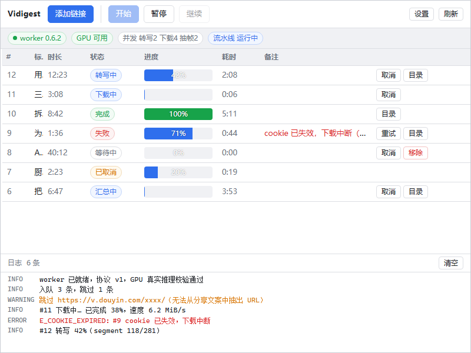
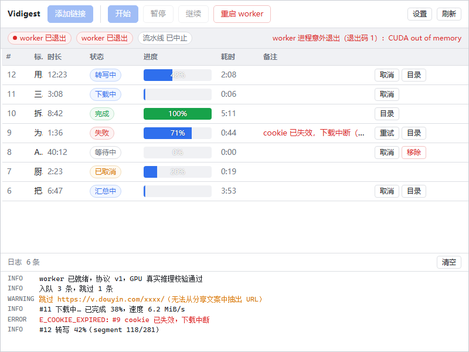

# 主界面版式改版 · 设计记录

| 项 | 值 |
|---|---|
| 日期 | 2026-10-27 |
| 起因 | 用户原话：「目前效果非常好，希望主画面的 UIUX 也要进行优化」（承接设置页改版） |
| 范围 | **只改版式与交互**。RPC 协议、状态机、任务字段、Python 后端一行没动 |
| 涉及文件 | `App.tsx`（布局串联）· `App.css`（重写）· `TaskTable.tsx`（重写为列表）· `TopBar.tsx`（**新增**，含状态区）· `mainLayout.ts`（**新增**，状态→视图纯函数）· `LogPanel.tsx`（可折叠）· `AddTasksBar.tsx`（改受控）· **删除** `StatusBar.tsx` · **新增** `main-preview.html` + `src/main-preview.tsx`（仅开发用）· `tools/main_layout_selftest.mts`（**新增** 24 条判据） |
| 状态 | 代码已完成；`./dev.sh check` 全绿（含新增的 24 条）；**尚未出包、未在真机点过**（见 §5） |

---

## 1. 现状诊断（改版前实测，口径可复跑）

| 指标 | 值 | 复跑命令 |
|---|---|---|
| **标题列可用宽度** | **26px ≈ 一个字** | `git show HEAD:app-ui/src/App.css \| grep -E '^\.col-(id\|dur\|status\|progress\|note\|actions\|elapsed)' -A1 \| grep -o '[0-9]\+px'` → 48+72+92+132+72+190+168 = **774**；800 − 774 = 26 |
| 任务表列数 | 8（序号/标题/时长/状态/进度/耗时/备注/操作） | `<th` 计数 |
| 顶栏横条数 | 2（工具栏 + 状态栏），合计 **78px / 600 = 13%** | 截图实测 y=0–46 与 46–79 |
| 日志区 | `flex: 0 0 168px` **常驻展开**，占 28% 高度 | `git show HEAD:app-ui/src/App.css \| grep -A2 '^\.logpanel {'` |
| 主操作按钮 | 3 个并排（开始/暂停/继续），**任意时刻只有一个可点** | 截图 + `disabled` 条件 |
| 状态 chip | 4 个（worker 版本 / GPU / 并发明细 / 流水线） | 截图 |
| 「在跑」状态用色 | 11 个状态里 **7 个**都是同一个蓝色 `tone:"active"` | `grep -c 'tone: "active"' app-ui/src/worker/types.ts` → 7 |
| 进度百分比 | 白字压在进度条上 ⇒ 42% 时条只盖左半，文字落在灰底上看不见 | 截图里只剩一个孤立的「%」 |

**根因一句话**：这套界面是按「把数据库字段一列一列摆出来」设计的，不是按「用户要看什么」设计的。七个固定宽度的列把唯一必读的信息（这是哪个视频）挤成一个字；三个互斥按钮并排，等于让用户先做一次「哪个是亮的」的判断；七个不同阶段共用一种颜色，等于颜色的信息量为零。

改版前正常态（标题列只有一个字）：



改版前故障态（一句话说了两遍，原因排在最后）：



---

## 2. 设计决策（每条给理由，不是给风格）

### 2.1 表格 → 两行式列表

**决策**：标题独占第一行（全宽），状态/阶段/进度/耗时退成第二行的元信息。

**理由**：800×600 是写死在 `tauri.conf.json` 里的默认窗口，也是这台机器上多数人第一次看到的尺寸。8 列在这个宽度里数学上就不可能都放下 —— 要么砍列，要么牺牲标题。而「这是哪个视频」是任务队列里唯一无法从别处获得的信息，其余全都能从状态推出来。列对齐是美观，标题可读是可用，冲突时让位。

**代价**：多行时各列右边缘不再对齐。用「状态 chip 定宽 64px」把每行**标题的左边缘**钉成一条竖线，保住列表最重要的对齐线。

### 2.2 一条横条，不是一个顶栏加一个状态栏

**决策**：状态并进顶栏右侧（两个 chip），异常另起一条 `alertbar`。

**理由**：三条一起看才成立 ——
1. 600px 高度里 78px 的横条是 13%，而这两条里有一半信息重复：worker 挂掉时，状态栏同时出现「worker 已退出」chip 和右侧同义的灰字说明。
2. 用户真正每天要看的状态只有两个：**连上没有**、**GPU 能不能用**。并发明细（`转写2 下载4 抽帧2`）是工程指标，挪进 tooltip。
3. 「worker 不在了」是**阻塞**，和「GPU 可用」不是一个量级的信息，不该长得一样大。现在它独占一条 alert，带原因和「重启 worker」按钮 —— 改版前原因在右侧灰字里排最后。

### 2.3 主操作位：三个按钮 → 一个

**决策**：空闲/中止 → 「开始」，运行中 → 「暂停」，暂停 → 「继续」。

**理由**：三者互斥。并排放着，用户每次要先做一次判断题；而且灰掉的两个仍在占位、仍在消耗注意力。`aborted` / `stopped` 都回到「开始」——用户不需要知道这两者的区别。

「暂停」用琥珀描边而不是实心蓝：它既不是主操作（主操作是「添加链接」），又要区别于普通次要按钮，因为点了会停掉正在跑的活。

### 2.4 四段阶段点，代替七个同色状态词

**决策**：`下载 → 转写 → 抽帧 → 汇总` 四段，已完成/进行中/未到三态。

**理由**：改版前 11 个状态里 7 个共用 `tone:"active"` 同一个蓝色（`下载中/待抽音频/转写中/待抽帧/抽帧中/待汇总/汇总中`），扫过去全是蓝的 —— 颜色的信息量为零。更糟的是它把**「在跑」和「在等并发位」画成一样**：`待抽帧` 正在排队，界面却和 `抽帧中` 长得一样。

阶段点回答的是另一个问题：**还剩几步**。这一点单阶段的百分比答不了。

⚠️ 三个中间态（`downloaded` / `transcribed` / `framed`）映射到**已结束**的那一段，且 `running=false` —— 这是最容易写反的地方，已进判据（见 §4 第 2–4 条）。

### 2.5 进度条：百分比移到条外

**决策**：5px 细条 + 右侧固定宽度数字。

**理由**：改版前是白字压条 + `text-shadow`。42% 时条只盖住左半边，居中的文字大部分落在灰底上，白字灰底几乎不可见 —— 实测截图里只剩一个孤零零的「%」。

`pending` 一条都还没开始，**不给进度位**：渲染 0% 的空条只会让人以为「卡在 0」。

### 2.6 日志默认收起

**决策**：收起成 30px 一行（`▸ 日志 6 条 · 1 错误 · 清空`），点开才 200px。

**理由**：168px 常驻占 28% 高度，而多数时候用户不读日志。训练用户「无视一大块区域」比不给这块区域更糟。收起时仍显示条数与错误数，**出错也不自动展开** —— 自动展开会打断正在看列表的人。

### 2.7 空态

**决策**：图标 + 一句「还没有任务」+ 一句说明产出 + 主按钮 + 一行补充（支持本地路径）。

**理由**：改版前只有两行灰字，且提示的是「点左上角『添加链接』」—— 让用户在空界面里找按钮。现在按钮就在中间，且**和顶栏那个是同一个输入框**（`AddTasksBar` 改成受控），不会出现两个入口各持一份半截文本。

---

## 3. 信息架构映射

| 原来（8 列表格） | 现在 |
|---|---|
| 序号 `task_id` | **去掉**。内部标识，对用户没有决策价值 |
| 标题 | 主行，全宽 |
| 状态 | 主行行首 chip（定宽 64px）+ 行左侧 3px 色条（只在「在跑」与「出错」上色） |
| 进度 | 元信息行：阶段名 + 四段点 + 细进度条 + 百分比 |
| 时长 / 耗时 | 元信息行合并成 `已耗时 / 视频时长` |
| 备注（重试次数） | 元信息行 |
| 备注（错误文本） | 元信息行，红色，占满剩余宽度（原来只有 190px，一律省略） |
| 操作 | 主行右侧（重试/取消/移除 + 转写稿 + 目录图标） |
| 状态栏「worker 版本」 | 顶栏 chip 的 tooltip |
| 状态栏「并发明细」 | 顶栏 chips 的 tooltip |
| 状态栏「流水线 运行中」 | 由主操作位本身表达；异常时进 alert |

---

## 4. 验收判据

### 4.1 自动判据（已挂进 `./dev.sh check`）

`tools/main_layout_selftest.mts`，**24 条，纯函数，秒级，不需要 GPU / Rust**：

```
node --experimental-strip-types tools/main_layout_selftest.mts
```

覆盖 §2.4 与 §2.2 里所有「看起来显然、写反了也不报错」的映射：中间态不是「在跑」、`pending` 不给阶段、失败不猜阶段、`gpu_verified === null` 不说「不可用」、重启中不说「可用」、连接 chip 不说「worker 已退出」（那句归 alert）。

`tsc` 只能保证类型对，保证不了语义对 —— 「待抽帧」渲染成「抽帧中」照样编译通过。

### 4.2 目视判据（截图在 `docs/images/主界面改版-2026-10-27/`）

| # | 判据 | 结论 |
|---|---|---|
| V1 | 800×600 下标题**完整可读**，不再只剩一个字 | 通过（改版前只显示 1 字，见 §1 截图） |
| V2 | 7 条任务在 800×600 内一屏可见，无需滚动 | 通过 |
| V3 | 顶栏只有一条；故障时 alert 独占一条且带原因 | 通过 |
| V4 | 「在跑」与「在等」可区分（阶段点 active vs done） | 通过 |
| V5 | 任一百分比（42%）在灰底与蓝底上都可读 | 通过（数字移出条外） |
| V6 | `pending` 不显示 0% 空条 | 通过 |
| V7 | 空队列有空态引导，按钮与顶栏打开**同一个**输入框 | 通过（代码层面；真机未点） |
| V8 | 输入区展开时工具栏不被挤变形（按钮不折行） | 通过（第一版被挤成两行，已改成整行独占） |
| V9 | 680px 窄窗口不塌（隐藏副标题、缩窄进度条、隐藏耗时） | 通过 —— ⚠️ 见 §5 第 3 条的方法坑 |
| V10 | 日志展开后列表仍可滚动、不撑破布局 | 通过 |

---

## 5. 未验证 / 已知取舍

1. **没在装了 MSI 的真机里点过。** 所有截图来自 `main-preview.html` + 假数据。真实 `get_config` 数据、真实事件流下的行状态刷新、`applying` 中间的 worker 重启、下载中进度都不在这个预览里。设置页改版也是同一处缺口，两次都还没补。
2. **没有深色主题。** 新色值（`--border-soft`、`#8b919c`、`#e1e4ea` 等）是只按浅色算的。
3. **预览页的方法坑（已修正，留作记录）**：第一版给预览容器写死 `width:800px` 来「模拟 800px 窗口」，结果 `@media` 看的是 **viewport** 而不是容器宽度，`max-width:720px` 的规则永远不触发 —— 窄窗口那条判据等于没验。现在预览铺满视口，靠截图时的窗口尺寸模拟真实窗口。
4. **`aria` 与键盘顺序没有系统过。** 行内只有原生 `button` / `div[role=button]`（日志标题），没有 roving tabindex，没有行选中态。列表里 Tab 会依次停在每一行的每个按钮上，行数多时很累。
5. **右键菜单仍是唯一的批量入口。** 没有多选、没有批量取消/重试 —— 这与「批量勾选 UI」那条待办是同一件事（`docs/架构_多平台与批量下载.md` §6 第 ② 项）。
6. **`转写稿` 按钮常驻在已完成行上。** 它和「目录」图标功能相关，一度想合成一个，最后保留两个：产物有两个（`transcript.txt` 与整个输出目录），合成一个就得藏起一个。
7. **删掉了 `StatusBar.tsx`。** 它的三态 GPU 逻辑**逐字**搬进了 `mainLayout.ts`（含全部注释），组件本身不再需要 —— 状态区已经并进顶栏，再留一个「只有一行 chip 的组件」等于留一份可能被改歪的第二实现。

---

## 6. 复跑预览

```bash
cd app-ui
npx vite --port 1430        # 然后开
# http://localhost:1430/main-preview.html
#   ?state=busy | empty | broken | nomodel
#   &composer=1   输入区展开
#   &logs=1       日志展开
#   &w=680&h=560  固定容器尺寸（⚠️ 媒体查询不会跟着变，见 §5 第 3 条）
```

截图（无头 Chrome）：

```bash
CHROME="/c/Program Files/Google/Chrome/Application/chrome.exe"
"$CHROME" --headless=new --disable-gpu --hide-scrollbars --no-sandbox --no-proxy-server \
  --user-data-dir=/tmp/cprof-x --window-size=800,600 --virtual-time-budget=9000 \
  --screenshot=/tmp/out.png "http://localhost:1430/main-preview.html?state=busy"
```

`main-preview.html` / `src/main-preview.tsx` 不在 Vite 构建入口里（`vite build` 只输出 `index.html`），不会被打进安装包。
