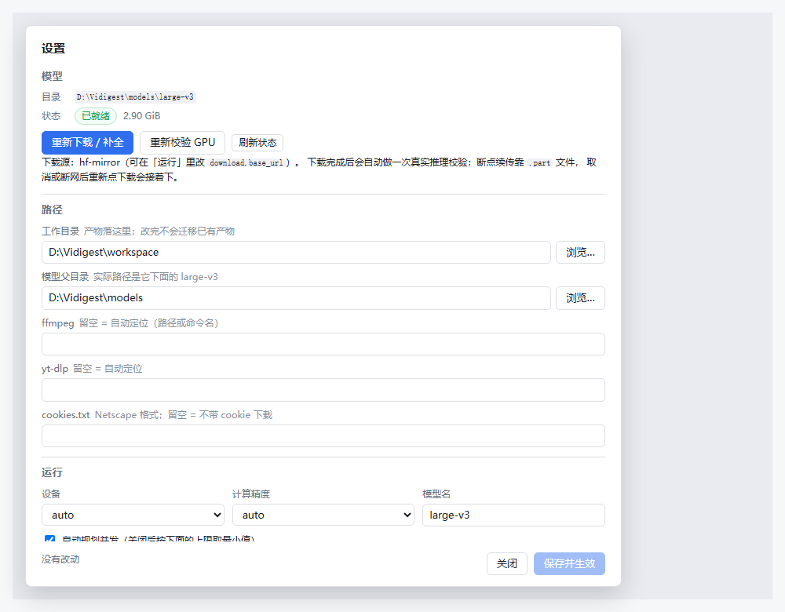
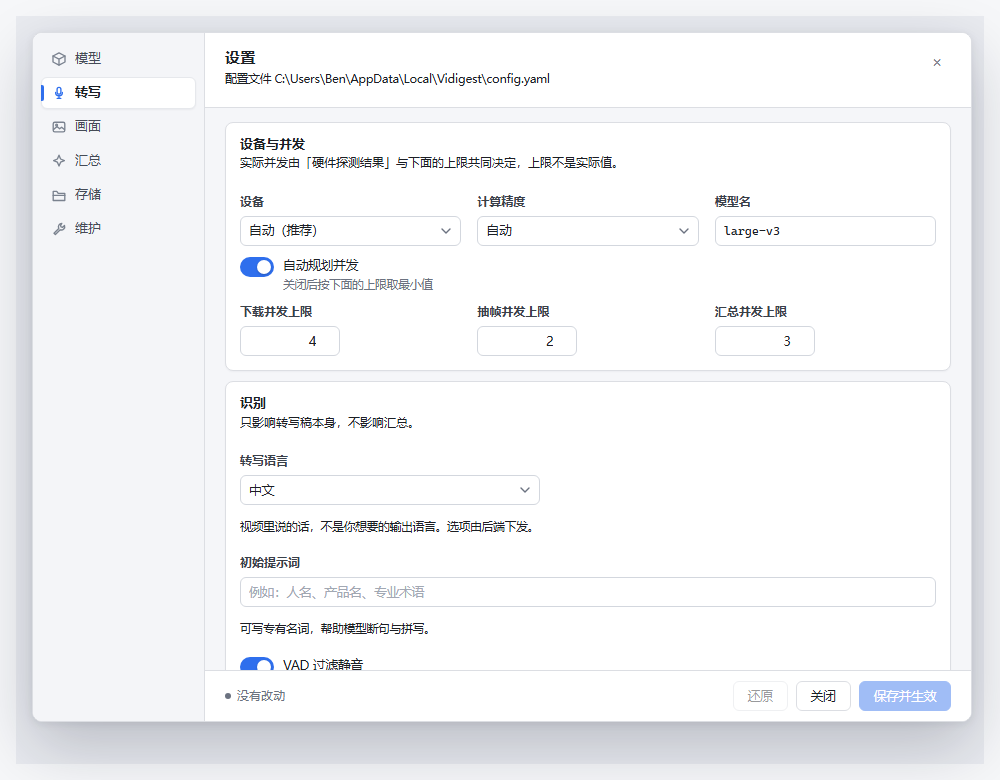
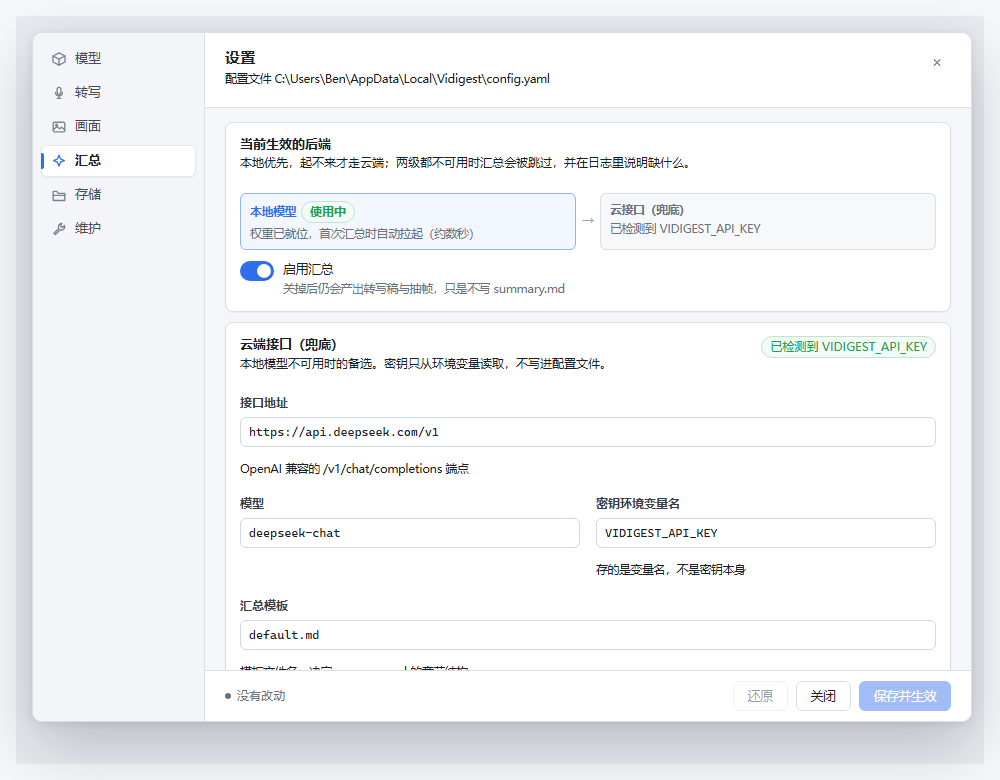
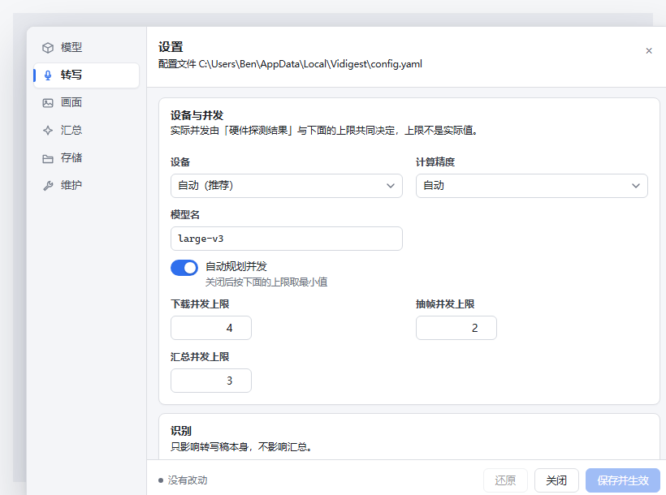

# 设置页版式改版 · 设计记录

| 项 | 值 |
|---|---|
| 日期 | 2026-10-27 |
| 起因 | 用户原话：「把设置的 UI 排版进行优化，现在看起来就是很不专业工程 demo」 |
| 范围 | **只改版式与交互**。配置语义、字段名、`Config` 结构、RPC 协议、后端一行没动 |
| 涉及文件 | `SettingsDialog.tsx`（重写排版）· **新增** `settings/primitives.tsx` / `settings/settings.css` · `ModelPanel.tsx` · `DirsGuide.tsx` · `App.css`（删旧样式）· **新增** `preview.html` + `src/preview.tsx`（仅开发用） |
| 状态 | 代码已完成、类型检查与构建通过；**尚未出包、未在真机点过**（见 §5） |

---

## 1. 现状诊断（改版前实测，口径可复跑）

| 指标 | 值 | 复跑命令 |
|---|---|---|
| 单文件行数 | 962 | `git show HEAD:app-ui/src/components/SettingsDialog.tsx \| wc -l` |
| 平级 section | 9（全是 `className="settings-section"` + 灰 `h3`） | `grep -c 'className="settings-section"'` → 9 |
| 手抄字段结构 | 99 行 `className="field…"`，覆盖约 30 个字段 | `grep -c 'className="field'` → 99 |
| 说明段落 | 11 段 `settings-hint`，多数写的是**工程推理**，不是操作提示 | `grep -c 'className="settings-hint"'` → 11 |
| 导航 / 分组 | **0**。全部内容一条滚动条 | 目视 + 无任何 nav 标记 |
| 控件宽度纪律 | **0**。所有 input 都是 `width:100%` ⇒ 「端口」输入框约 600px 宽 | `.field input { width: 100% }` |
| 开关 | **0**。4 个布尔项用原生 checkbox 混在 30px 输入框之间 | `grep -c 'type="checkbox"'` |

**根因一句话**：层级只有一个手段 —— 灰色 `h3` + 1px 分割线。于是「11 个字段的段」和
「1 个字段的段」视觉权重完全相同，**等权 = 没有层级**。用户说的「工程 demo 感」，
指的就是这个：所有东西都在、都排得整齐，但没有告诉眼睛先看哪里。

次要成因（同样进方案）：

1. **控件宽度不表达语义**：一个「端口」和一条安装路径一样宽。
2. **布尔项不合群**：原生 checkbox 12px，旁边输入框 30px，基线永远对不齐。
3. **说明文字抢位置**：`<em class="field-hint">` 挂在标签里，长提示会把标签挤换行
   （"转写语言 / 视频里说的话，不是你想要的输出语言" 这类）。
4. **没有「我现在改了什么」的反馈**：只有 footer 一行灰字「有未保存的修改」。

改版前（同一份假配置渲染）：



三处硬伤在这张图里都能直接看到：`auto` 这种**枚举原值**直接给用户看；「路径」下面
五个输入框**一样宽**（包括本该 120px 的端口类数字）；底部的
「自动规划并发」复选框被卡片边界切掉一半 —— 因为它和 30px 输入框不同高、不对齐。

---

## 2. 设计决策（每条给理由，不是给风格）

| # | 决策 | 理由（不这么做会怎样） |
|---|---|---|
| D1 | **左侧 6 类导航 + 右侧内容** | 9 段平铺没有入口。分类按「用户想修什么」切，不按配置分节切（配置里 `runtime/transcribe/frames` 是三个 dict，用户眼里只是「转写」「画面」两件事） |
| D2 | **卡片取代 h3 + 分割线** | 卡片天然带边界，一张卡 = 一件事；分割线只能表达「下面还有」，不能表达「这是另一件事」 |
| D3 | **控件宽度按语义**：路径占满 / 数字 120px 右对齐 / 下拉 ≤300px | 让宽度本身携带信息。数字右对齐 + 等宽数字，扫读时位数对得上 |
| D4 | **布尔项改开关**（原生 checkbox 透明覆盖） | 开关是「功能级」语义，checkbox 是「列表选中」语义。这里全是功能开关。保留原生 input 是为了键盘 Tab / 空格 / 读屏 / `disabled` 全都免费成立 |
| D5 | **长解释折叠成 `▸ 下载源与断点续传`** | 工程推理有价值但要可查不可挡路。保留为 `title` 会丢内容，删掉会丢知识 —— 折叠是唯一两条都满足的形态 |
| D6 | **分类级状态点**：蓝点 = 该组有未保存改动；琥珀点 = 该组还有未完成的准备（模型没下） | 原来改了三处，只有 footer 一行字，**看不出改在哪一组**。`dirtyKeys` 复用的是同一份 diff 结果，不另算一遍 |
| D7 | **后端优先级画成阶梯**（本地 → 云 → 无） | 这是全页唯一「需要判断」的地方（现在到底用哪个后端）。原文是一句话 + 一个 chip，读起来像附注；画成阶梯后一眼看到链路和断点在哪 |
| D8 | **底部恒存状态条**：状态点 + 文案 + `还原` + `关闭` + `保存并生效` | 按钮位置恒定（不随滚动跑），状态与动作在同一视觉行 |
| D9 | **关闭前确认 + Esc** | 原来点 × 或按 Esc **静默丢弃**整页改动。只在 really dirty 时问，不打扰 |
| D10 | **表单件收敛成原语**（`TextField` / `NumberField` / `SelectField` / `Toggle` / `Field`） | 改版前每个字段各写 3–4 行标签/提示/控件结构，于是「标签字号、提示位置、控件宽度」这三件事**有三十多个略微不同的版本**。这就是不专业感的物理来源，不是配色 |

**没有做的（刻意）**：

- 不做设置搜索。当前 30 个字段、6 类，搜索的收益小于它带来的状态复杂度。
- 不做「基础 / 高级」两档。已经用分类 + 折叠表达，再加一档会让「高级」变成垃圾桶。
- 不改任何字段默认值、不改任何后端校验。

---

## 3. 分类映射（9 段 → 6 类 / 14 张卡）

| 新分类 | 收纳的旧 section | 配置分节 | 卡数 |
|---|---|---|---|
| 模型 | 模型（语音）、本地模型（可选） | `local_ai` | 2 |
| 转写 | 运行、转写（含分段参数） | `runtime` `transcribe` | 3 |
| 画面 | 抽帧、画面理解（可选） | `frames` `vision` | 2 |
| 汇总 | 汇总 | `summarize` | 2 |
| 存储 | 路径、下载 | `paths` `download` | 3 |
| 维护 | 维护、配置文件脚注 | — | 3 |

`GROUPS[].keys` 同时是「这一组有没有未保存改动」的判据，所以分类与配置分节是**多对多**，
不需要为导航单独维护一张表。

改版后：






窄窗口（默认 800×600 的 Tauri 窗口会命中这条分支，三列降两列、不塌成单列）：



---

## 4. 验收判据

| # | 判据 | 命令 / 手段 | 结果 |
|---|---|---|---|
| V1 | 类型干净 | `cd app-ui && npx tsc --noEmit` | ✅ 无输出 |
| V2 | 构建通过且**预览页不进产物** | `npx vite build` + `ls dist` | ✅ `dist/` 只有 `index.html` + `assets/` |
| V3 | 六个分类都能渲染 | `preview.html?only=<group>` 逐张截图 | ✅ 6 张，md5 各不相同（第一版全是同一张，见 §5 坑 1） |
| V4 | 800×610 窄窗口不塌 | 同截图，`--window-size=820,610` | ✅ 三列降两列，未塌成单列 |
| V5 | 未保存态可见 | `preview.html?only=model&dirty=1` | ✅ 导航蓝点 + 琥珀状态点 + `还原` 可用 + 保存变实心蓝 |
| V6 | 关闭确认只在 dirty 时触发 | 代码路径 `requestClose` | ✅ 未保存才 `confirm` |
| V7 | 旧样式零残留 | `grep -rc 'className="field\|className="settings-\|className="banner' app-ui/src/components/*.tsx` | ✅ 全部 0 |
| V8 | 全量检查绿 | `./dev.sh check` | ✅ 下载器 11/11 · Rust 23/23 · tsc ok |

截图复跑（服务端已起在 1430）：

```bash
CHROME="/c/Program Files/Google/Chrome/Application/chrome.exe"
"$CHROME" --headless=new --disable-gpu --hide-scrollbars --no-sandbox --no-proxy-server \
  --user-data-dir=/tmp/cprof-x --window-size=1000,780 --virtual-time-budget=12000 \
  --screenshot=/tmp/x.png "http://localhost:1430/preview.html?only=summarize"
```

---

## 5. 未验证 / 已知取舍

**未验证**

1. **没在装了 MSI 的真机里点过**。本次全部靠 `preview.html` + 写死的假配置验证渲染，
   真实 `get_config` 数据、下载中的进度条形态、`applying` 转圈都**没有眼见**。
2. **深浅色**：应用本来就只有浅色一套，本次没做深色。
3. **键盘走查只做到 Esc**：没有做焦点圈定（tab 能跳出弹窗）。

**取舍**

1. `SettingsDialog.tsx` 从 962 行变成 1119 行 —— **没变短，是变清楚了**。
   净增来自分组 JSX 与注释，减掉的是 99 行手抄字段结构（现在 39 处一行式声明）。
   要变短得拆文件，那属于「版式稳定之后」的纯搬运，不在本次。
2. 分类里「存储」= 目录 + 外部工具 + 下载行为，是三件事塞一类。真实收益是
   **把最不常改的三组挤到一屏之内**，代价是语义上略糙。若后续加设置项，这里第一个拆。

**本次踩到的两个坑（留给下一个人）**

1. **截图全是同一张**：`preview` 里靠点导航项切分类，而首帧 `draft` 还是 null、弹窗渲染的是
   「正在读取配置…」，导航项**根本不存在**，点空 ⇒ 六张图全是「模型」。修法是重试轮询。
   判据是 `md5sum shots/*.png | sort -u | wc -l`，**必须是 6**。
2. **预览必须 import `App.css`**：只导 `settings.css` 时 `--accent` / `.chip` / `button.primary`
   全缺失，看到的是「像但不对」的排版（第一版截图里主按钮没有蓝色）。
